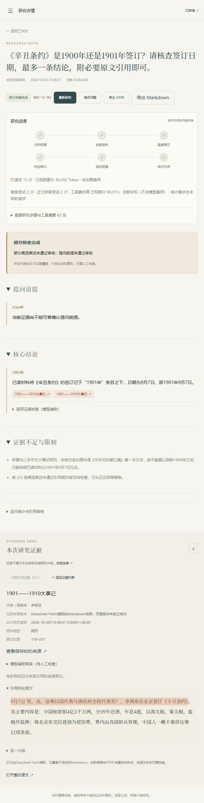

# 在线优先 P0：实现与真实验证

日期：2026-10-20。该批次独立于此前 P0/P1/P2 验证，未覆盖或重写旧结果。已部署本机服务，未提交或推送 GitHub。

## 交付范围

- 默认「全网历史研究」，DeepSeek Search 搜索候选，Fetch 读取正文；普通聊天接口不冒充联网。支持古今中外问题输入，不限制安史之乱关键词。
- 「限定资料研究」明确使用当前资料库；兼容旧 hybrid 记录。原有 11 份资料的 ID、标题、内容哈希全部保留，全网工具不会搜索预装专题库。
- 搜索摘要只作线索。已抓取正文保存 MySQL，片段、邻文、正文哈希与引用位置可复核；本次网页阅读不依赖 Embedding/Milvus 成功，后台另行建索引。
- 同 URL 规范化、同正文哈希去重；即使复用旧正文，任务证据仍保存本次实际来源 URL、标题、读取时间及版本未知说明。近似转载识别仍不可靠，多个 URL 不等于独立史源。
- Search / Fetch 各自限次；每次回执保存状态、耗时、计费是否明确与工具费估算。浏览器逐次显示模型输入/输出 Token 和工具回执，断线后可回放；总额未知时保留已知小计。
- 候选链接与失败原因带回规划节点，失败 URL 不重复请求；普通事实题允许可靠机构正文，不强制追到条约原件或无关法律条款。
- 时间或模型预算耗尽时返回未完成核查；若修订前已有通过检查的结果则保留旧版，未经检查的草稿不展示。该恢复修复通过离线回归，未再人为耗费真实模型预算验证。

技术栈未替换：Python 3.11、LangGraph、LangChain、DeepSeek、MySQL、Redis、Milvus、FastAPI、原生 HTML/CSS/JS 与 Compose。未新增依赖，`uv.lock` 保持原锁定版本。

## 官方接口与安全边界

核对 [Search 指南及中文计费说明](https://api-docs.deepseek.com/zh-cn/guides/search/)、[Search 协议](https://api-docs.deepseek.com/api/search/)、[Fetch 协议](https://api-docs.deepseek.com/api/fetch/)。

默认工具地址 `https://api.deepseek.com`；分别请求 `/v1/tools/search`、`/v1/tools/fetch`。Search 查询最多 128 字符，每次取 5 条、`need_content=false`。工具 Key 可独立配置，留空复用聊天 Key；工具地址不从聊天中转地址推断。未配置时明确报错，不静默使用旧语料冒充全网。

本次按明确配置的 5 元/千次估算成功 Search / Fetch 工具费。它不是聊天 Token 费用、账户账单或完整实扣总额。200 且有结果/正文才记为成功计费；空响应、HTTP 错误与客户端超时分别记录，超时不当作免费。提供商成功返回的访问拦截页仍可能计费，后续正文校验失败不会抹掉回执。

提交 Fetch 前验证 HTTP/HTTPS、80/443、无 URL 凭据与初始 DNS 公网地址；工具响应有超时、体积与结构上限。DeepSeek 负责实际远程连接，本项目无法固定其下游 IP、校验全部重定向或取得实际最终 URL。保存的是提取后的 Markdown，引用偏移基于该文本，不能冒称原始 HTML、固定修订或影印页码。已观察到的 Incapsula 拦截页增加了拒绝处理，但没有声称能自动识别所有错误页。

网页仅作不可信资料，不执行其中指令。密钥不进入前端、事件和报告。

## 实际测试

1. 全套 **111 passed / 42.88 秒**。包括两项真实 MySQL、Redis、Milvus、BGE 集成测试；模型与付费搜索均使用明确测试替身。这证明相应协议与状态处理，不证明真实历史质量。
2. 最后仅调整费用小计后，针对性 **20 passed / 2.08 秒**；Ruff 与 `node --check shijian/static/app.js` 通过。
3. 使用已有锁定依赖离线增量构建镜像，重新安装项目 wheel，核对容器实际加载文件与源码哈希一致；API、MySQL、Redis、Milvus 等健康，两个 worker 运行。未重新做完整无缓存构建。
4. 原有 11 份资料 ID、标题、哈希逐项核对未变；目前共 15 份，新增 4 份来自实测网页（包含修复前保存的一份访问拦截页，保留失败现场，不能视作有效史料）。
5. 浏览器核对默认全网模式、研究详情、逐次用量回放、失败入口、精确引用 `<mark>` 高亮、上下文、读取时间和版本提示。Markdown 导出接口实测成功，不额外调用模型。

## 真实请求：两道题、三次尝试

| 实际运行 | 状态与结果 | 模型请求 / Token | 搜索 / 抓取 | 已知工具费估算 |
|---|---|---:|---:|---:|
| 凡尔赛题首次 | completed，但无正文、无引用，证据不足；成功链路断言未通过 | 9 / 15,848 | 3 / 3 | ¥0.015 |
| 凡尔赛题修复后重试 | failed；读到正文，但修订检查阶段达到 16 请求上限；因此发现并修复结果保留问题 | 16 / 49,993 | 2 / 4 | ¥0.025 |
| 辛丑条约日期题 | completed / partial；2 轮、4 次工具调用，核心日期结论通过检查，2 条引用精确定位 | 13 / 30,202 | 2 / 2 | ¥0.015 |
| **合计** | **保留全部失败，不当作三次成功** | **38 / 96,043** | **7 / 9** | **¥0.055** |

模型累计输入 82,960、输出 13,083 Token。共有 3 次抓取超时，是否计费未知；故工具总费用未知，0.055 元仅为已知部分估算。模型金额及实际账户扣款均为空。没有运行新一轮 90 条对比，也没有编造人工评分。

逐次回执与聚合见 [用量记录](online-p0-usage.json)。原始记录：

- [凡尔赛首次](online-p0-versailles.json)：任务 `d542588b-ac39-4814-95c7-587411a53219`。
- [凡尔赛重试](online-p0-versailles-retry.json)：任务 `663494c9-107f-44cd-94b3-86ec729a7ffe`。
- [辛丑条约题](online-p0-boxer.json)：任务 `f224d438-2889-46ac-aced-e2e2219ba385`，WebSocket 主动断开后任务继续，重连回放 40 个事件，13 次模型和 4 次外部请求回执与最终结果一致；引用摘录、URL、正文全局偏移均经程序核对。
- [保存结果的 Markdown](online-p0-example.md)、[部署与源码清单](online-p0-manifest.json)。

## 真实失败与待完善事项

凡尔赛首次遇到一次超时、两次 Fetch 404；系统没有用搜索摘要补成“已读证据”。重试取得联合国术语库、剑桥公开章节摘录，同时遇到访问拦截页；原始结果未重写。该次运行暴露的预算恢复与拦截页拒绝已修复并测试，未再付费重跑此题。

辛丑条约题读取中国社会科学院近代史研究所的 [1901—1910 大事记](http://jds.cass.cn/ztlm/jdbk/201605/t20160506_5257606.shtml)，引用分别定位年标题和日期句。它是现代大事记网页，非条约原件；原文中“奕？”的显示问题原样保留，不替换为未经校勘的人名。

**此题质量仍有问题**：结论已有日期支持，但前提判断被审核移除，局限段又过度保守地说无法排除另一个年份，并提及未实际读取的汇编书名。模型审核没有消除全部表述问题；该题只记录为 partial，不能称为全部正确或全史范围质量验证通过。改善前提表达、审核尺度与无依据的局限补写仍需后续迭代。

默认 4 轮、3 搜索、4 抓取、16 工具、16 模型请求、60,000 已观测 Token、240 秒总时间。这些是上限，不是承诺每题费用或成功率；在途响应可能超过 Token 观测阈值，提供商请求取消与计费无法保证同步撤回。实际调用后的用量均已向用户报告。

## 复现

```sh
# 真正调用模型及工具，消耗额度。只跑指定的一题，不批量重试。
uv run python scripts/smoke_live.py --mode online --question '需要核查的具体问题' --skip-cancel --output .cache/my-online-smoke.json

# 完全离线重新汇总本次用量：
uv run python scripts/online_report.py docs/online-p0-versailles.json docs/online-p0-versailles-retry.json docs/online-p0-boxer.json --output .cache/online-usage.json
```


