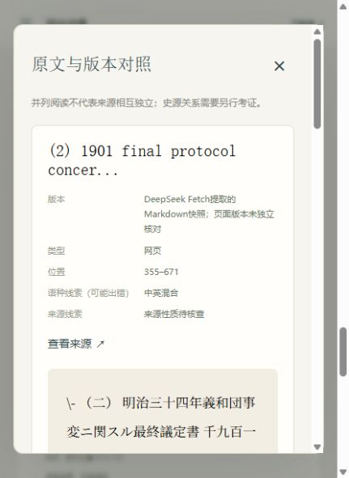

# 在线 P1：选源、长网页阅读、双语与跨主题评测

日期：2026-10-20。本轮接续在线优先 P0，原有专题 P0/P1/P2 报告与在线 P0 原始记录均保留。未创建提交或推送 GitHub。

## 已实现

- **选源**：候选 URL 规范化去重，机构/学术域名作为排序线索；记录查询语言与候选摘要，前端按来源线索、语言筛选。候选区与本次已读证据分开，摘要不可引用。机构域名不代表一手性或史实正确，也没有把所有来源打成“可信分”。
- **长网页阅读**：解析保存片段中的明确标题与年份行，返回最多80项目录。只返回8个开头片段ID，避免重复传数百UUID；模型可按目录或 `read_passage(source_id, query)` 在整份已取得正文中重新定位，无需再次 Fetch。阅读匹配段、邻文和所在节标题，保留 Unicode 原始偏移，原文不改写。
- **复用与转载**：已有全局正文哈希去重继续使用；本次最多4个网页之间增加字符片段相似提示。相似正文不合并、不删除，也不能累加为多份独立证据。全库缓存复用与本任务来源独立性分开说明。
- **双语研究**：分析阶段输出带语言与目的的查询计划；工具选择根据证据缺口使用中文或英文实体词，外文页可用原文关键词定位。`language`仅记录查询语言，不是DeepSeek搜索参数。原文引用与中文回答、模型辅助译述分别展示；翻译不能冒充原文通过引用校验。
- **对照与导航**：资料详情可按目录跳转并高亮保存位置；两段原文可并列核对版本、来源、语种线索与模型译述，同份正文或疑似转载有提示。
- **跨主题评测**：新增独立30题种子集、题集选择、零付费dry-run和真实worker记录归档工具。现有人工评分页面可查看本批两题；其余28题未运行，人工评分为空。

应用代码相对本轮开始快照约新增325行、删除54行（后续评测说明显示另有少量行调整）；测试、题集、归档脚本另计。未新增服务、模型角色、数据库表或依赖，锁文件不变。

## 实际验证

- 全套 **117 passed，38.56秒**，包含两项真实MySQL/Redis/Milvus/BGE集成验证；付费模型、搜索在测试中均为明确替身。新专项覆盖250多段后的英文尾部检索、标题上下文、原文偏移、未知source_id拒绝、转载提示与译文引用拒绝。
- 语种及回答范围修正后，相关22项测试通过；最后显示措辞与导出调整后相关16项测试通过（3.06秒）。不能将这些重复执行相加为新增测试数量。
- Ruff、JavaScript语法检查通过。CLI `--dry-run` 实测不读取模型配置、不连接数据库和模型。
- 已用现有依赖缓存构建、强制重装项目wheel并部署；这不是完整无缓存构建证明。最终源码/安装代码核对、健康状态及原资料保留检查见 [部署清单](online-p1-manifest.json)。
- 浏览器核对来源/英文候选组合筛选、目录跳转到原文位置103的“1901年”、资料对照中的原文/译述分离、逐次费用回放和未评分评测列表。页面筛选与查看均未再发起研究任务。

## 两道真实任务

| 题目 | 执行 / 证据覆盖 | 轮数 / 工具 | 模型请求 / Token | 搜索 / 抓取 | 工具费估算 |
|---|---|---:|---:|---:|---:|
| Q07 辛丑条约签订日期 | completed / partial；4条引用位置及来源核对通过 | 2 / 4 | 9 / 25,327 | 2 / 2 | ¥0.020 |
| Q13 独立宣言通过与签署 | completed / insufficient_evidence；未取得正文、没有引用，成功链路断言未通过 | 3 / 6 | 7 / 18,337 | 2 / 2 | ¥0.010 |
| **合计** | **一题部分结果，一题证据不足** | — | **16 / 43,664** | **4 / 4** | **¥0.030** |

累计输入38,556、输出5,108 Token。4次Search与2次Fetch有结果，另2次Fetch为404，按已核对的工具计费规则记0。此次无计费未知回执；0.030元是配置价格的工具费估算，不含模型费用，也不是账户实扣账单。调用后已逐批向用户报告每次输入/输出和本轮累计。没有第三题或整题付费重试。

- [中文题原始记录](online-p1-boxer.json)，任务 `c077ee22-aec5-45f4-af12-de8bf37f582a`：断线后独立worker继续，回放40个事件，9条模型回执与4条外部回执和最终结果一致。
- [外文题原始记录](online-p1-declaration.json)，任务 `2bf85067-e72e-4c7c-9e27-1ff380e38512`：原始失败现场保留，未用模型记忆补正文。
- [逐次用量](online-p1-usage.json)、[跨主题汇总](online-p1-report.json)、[供人工核查的两题](online-p1-cases/manifest.json)。直接回答与一次RAG本批未运行，不能称为三方案比较。

## 真实问题与限制

中文题读到现代大事记和日方档案目录的转录信息，不等于读到条约影印原件。它识别了同一大事记内两处年份不一致；候选答案进一步断言“应为笔误”，该条因缺乏充分支持被拒绝，结果因此partial。它还将原文“奕？”补成具体姓名，这一扩写没有在所选引文中充分体现，说明模型内容审核仍可能漏检。最终提示增加了只答所问日期及不凭记忆修补缺字的约束，未再付费复跑，不声称问题已在真实模型上完全消除。

初版语种规则把含假名的日文页标为中英混合，已补充假名识别并用测试验证；机构域名线索补充了实际遇到的中方研究机构与日方政府域名。历史任务保留当时的标签，前端明确称其为可能出错的“语种线索”，没有重写原始证据。

英文题的两个候选（Library of Congress馆藏页与DocsTeach页面）被DeepSeek Fetch返回404；使用安全HTTP客户端免费直读也失败。模型随后尝试未在本次搜索命中的URL，被工具范围检查拒绝。没有静默请求任意URL、绕过抓取限制或伪造正文。**英文长页定位与原文/译述边界通过了替身测试，真实英文题的完整回答链路仍未通过验证。** 不能把中英文搜索成功或代码实现当成跨主题回答质量通过。

真实两题之后只进行了离线修正、页面验证和部署。最终交付代码哈希不冒充两个付费任务当时的精确源码哈希（当时未单独归档，评测清单该字段为空）。没有同版本、同语料的稳定性或收益比较，也未填写人工评分。

转载提示仅在本任务正文前6万字符计算8字符片段Jaccard，阈值0.85、至少120字符。它可能误判模板相似，漏掉改写/翻译转载及正文后部共享，不是全库查重或史源关系证明。目录规则也不会识别所有HTML语义或书籍版式，未识别章节仍可按全文关键词定位。BGE仍是原中文模型，未验证英文向量检索质量；在线正文定位不依赖向量。

