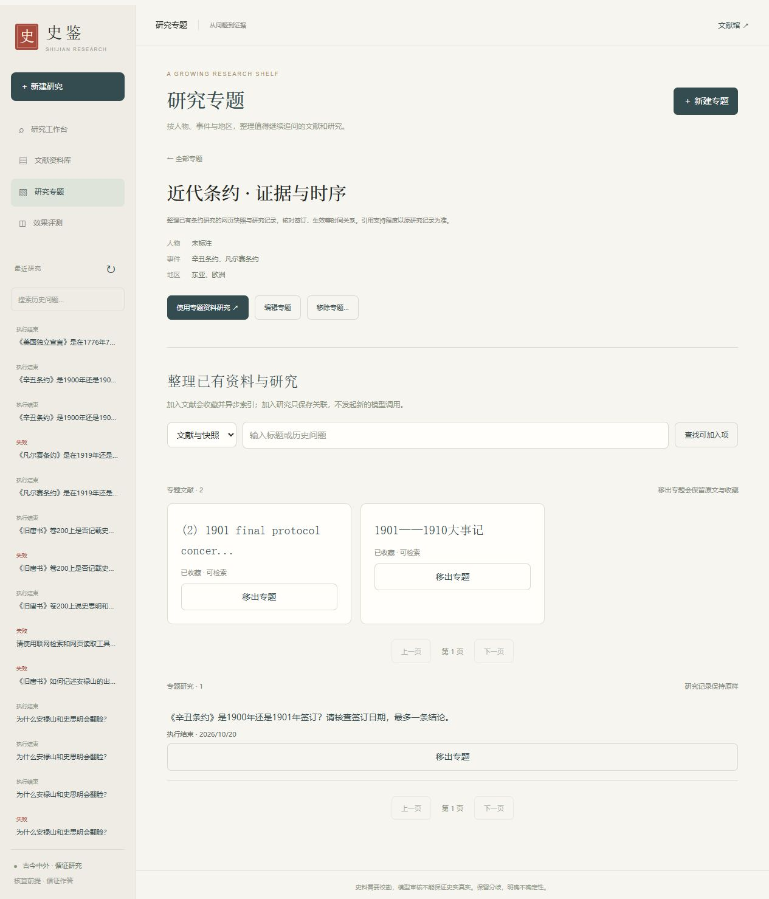
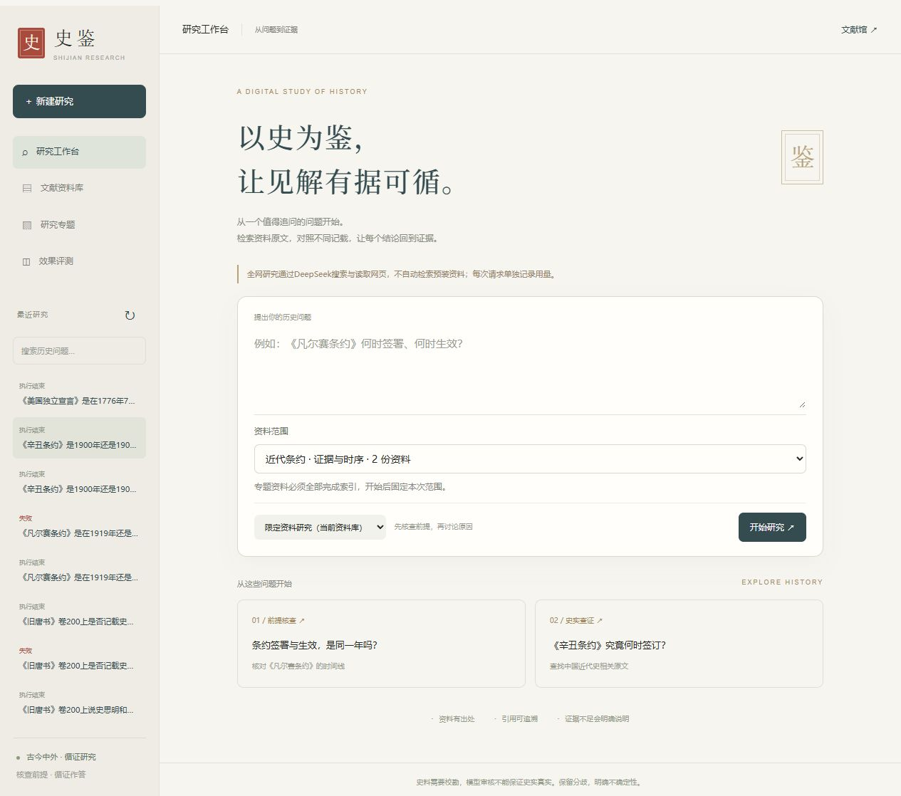

# 在线研究 P2：收藏、按需索引与研究专题

2026-10-21 完成并部署至本机 `http://127.0.0.1:8000/`。这轮针对在线优先路线的 P2；此前原文释读、引用审核的 P2 记录保留在 `p2-verification.md`。

## 实现与使用

- 研究取得的新网页先保存为 `saved=false / unrequested` 的证据快照。本次阅读不等向量，不自动把每个搜索页面加入长期检索库；手动导入默认收藏。相同正文仍按内容哈希复用，已收藏的资料不会被后来的抓取降级。
- 已读网页、引文阅读区及文献详情支持收藏和加入专题。收藏后复用 Redis 通知、MySQL 状态和独立索引 worker，显示排队、进度、错误与重试；已就绪的重复收藏不重建片段。
- 资料库支持已收藏 / 未收藏快照 / 全部筛选。取消收藏会排除未来本地检索，撤下未开始的索引；运行中的索引允许完成。原文、片段、向量和历史引用保留。
- 专题支持名称、说明及人物 / 事件 / 地区标签、分页浏览、筛选、编辑、加入与移出文献及历史任务。专题关联独立成表，不修改历史任务的更新时间或结果。移除专题只移除分类关系。
- 专题研究仅用于 local：创建任务时在同一事务内固定1–30份资料 ID 并关联专题，要求全部已收藏并完成当前 Embedding 索引；空专题和未就绪范围明确拒绝。worker 使用独立 Corpus 作用域，模型工具过滤不能扩大范围。专题后续编辑不改变该任务，重试保留原范围；启动时范围失效会在调用模型前失败。
- 全网模式不自动使用收藏或预装资料。专题只是组织工具，不把用户标签当作自动识别的史实。
- 迁移 `0003` 保留旧资料为已收藏，旧任务 `source_ids=NULL`；既有原文、章节、引用 ID 和结果不改写。

## 实际验证

| 层级 | 实际执行与结果 | 不能推导出的结论 |
| --- | --- | --- |
| 静态检查 | `ruff check shijian tests scripts eval migrations`、`node --check shijian/static/app.js`、`git diff --check` 通过 | 不代表回答质量 |
| 全量测试 | `.venv/Scripts/python.exe .cache/run_integration.py tests --junitxml=.cache/online-p2-all.xml`：126 passed，50.994秒，0失败、0跳过 | 测试模型不具备历史判断能力 |
| 真实基础设施 | 上述包含3项真实 MySQL / Redis / Milvus / BGE 测试；P2 新测快照不自动索引、收藏后索引、重复导入、专题固定范围 worker 与取消收藏后证据保留 | 不包含新的真实 DeepSeek 回答 |
| 迁移 | 独立 SQLite 从0002升级0003，验证旧原文、哈希与任务结果保留；真实 MySQL 测试库及生产库升级成功，运行版本0003 | 没有清空或重建生产卷 |
| 生产数据保留 | 升级前后同16份资料，source_id/content_hash集合完全一致；20条研究记录保留，未创建新生产研究任务 | 收藏不保证来源真实或许可充分 |
| 后台实际索引 | 已有中国社科院网页快照重建：观察到 pending → indexing → ready，35片段；限定该source_id检索返回8条，取消收藏期间返回空 | 不能据此评估跨语言向量召回率 |
| 幂等与历史记录 | 重复收藏与重复加入专题只保留一份关联；原文、目录、既有任务（含更新时间、结果）及证据快照前后相等 | 不做文献自动校勘 |
| 浏览器 | 实际新建专题、事件/地区筛选、加入已存文献和历史任务、研究详情归档、引用高亮与收藏、选择专题资料范围；控制台无error/warn | 未点击付费“开始研究”，手机尺寸未专项验证 |
| 部署 | 保留现有卷，离线增量构建并更新 api / worker / index-worker；MySQL/Redis/Milvus及依赖健康，API健康；运行JS哈希与工作区一致 | 未执行无缓存全量镜像构建 |

本轮新加8项收藏 / 专题 / 迁移定向测试，以及1项真实基础设施测试。全量测试完成后只调整了范围加载期间禁用提交和两处样式；最终JS语法、静态检查及浏览器重新加载已验证，未因此重复完整基础设施测试。

生产冒烟记录见 [online-p2-smoke.json](online-p2-smoke.json)。可复用命令仅操作已有资料和任务，不新建研究、不调用模型：

```powershell
.venv/Scripts/python.exe scripts/online_p2_smoke.py `
  --source-id d658f04d-be46-4b57-bd70-ef8ba683d9c3 `
  --task-id c077ee22-aec5-45f4-af12-de8bf37f582a `
  --collection-id 6e9642a7-35b0-40d0-bbd9-2298156c361f
```

这些 ID 是本机既有真实记录，其他环境应替换。脚本会临时取消/恢复收藏并重建该份资料索引，最后验证原文和历史证据不变。全量真实服务测试应只使用名字以 `_test` 结尾的独立数据库及测试向量集合；`.cache/run_integration.py` 是本机环境辅助，不是仓库安装前置条件，通用配置见 README。

页面已保留一个可使用的「近代条约 · 证据与时序」专题，关联2份已存网页和1次既有研究。它整理的是旧研究，仍显示原来“部分核查完成”的结果；没有生成或伪装新的研究结论。





## 运行环境与用量

本轮开始时 Docker 未运行。启动再次复现 Windows `dockerInference`、随后 `docker-secrets-engine/engine.sock` 的残留 AF_UNIX 端点错误。只将已核实的运行时目录原位改名保留，让 Docker 重建端点后启动成功，未删除或重置任何持久化数据；这不是 Docker 根本缺陷的永久修复。相同现象可参照 [Docker 官方问题库中的报告](https://github.com/docker/desktop-feedback/issues/460)。Compose 仍提示历史 model-cache 卷不是当前 Compose 创建；本轮复用该现有缓存，未迁移或清空它。

本轮新增 DeepSeek聊天请求 **0**、Search **0**、Fetch **0**，新增模型 Token **0**。索引使用本地 BGE，测试使用明确标注的协议替身。没有查询或推断账户余额，没有把上轮调用计为本轮。

## 限制

新建任务、联网与引用的真实模型质量沿用上一轮已公开边界：未补做30题完整跨主题三方案对比，未补人工评分，未新验证完整英语回答。收藏和专题不代表来源独立、原文准确或版权许可已获确认。快照不自动清理，会逐渐占用 MySQL 空间；取消收藏也不会自动回收向量。专题每页30项、研究范围最多30份，属于当前产品限制。资料取消收藏但仍留在专题时必须恢复收藏与索引，或移出后再开始该专题研究。

本轮保持已有栈与依赖锁定文件，未引入新框架或角色。工作区还包含前几轮未提交改动，不能把相对 Git HEAD 的总行数全算为本轮；改动集中在收藏/专题 API、模型与迁移、现有索引/Corpus边界、原生页面和验证脚本。
