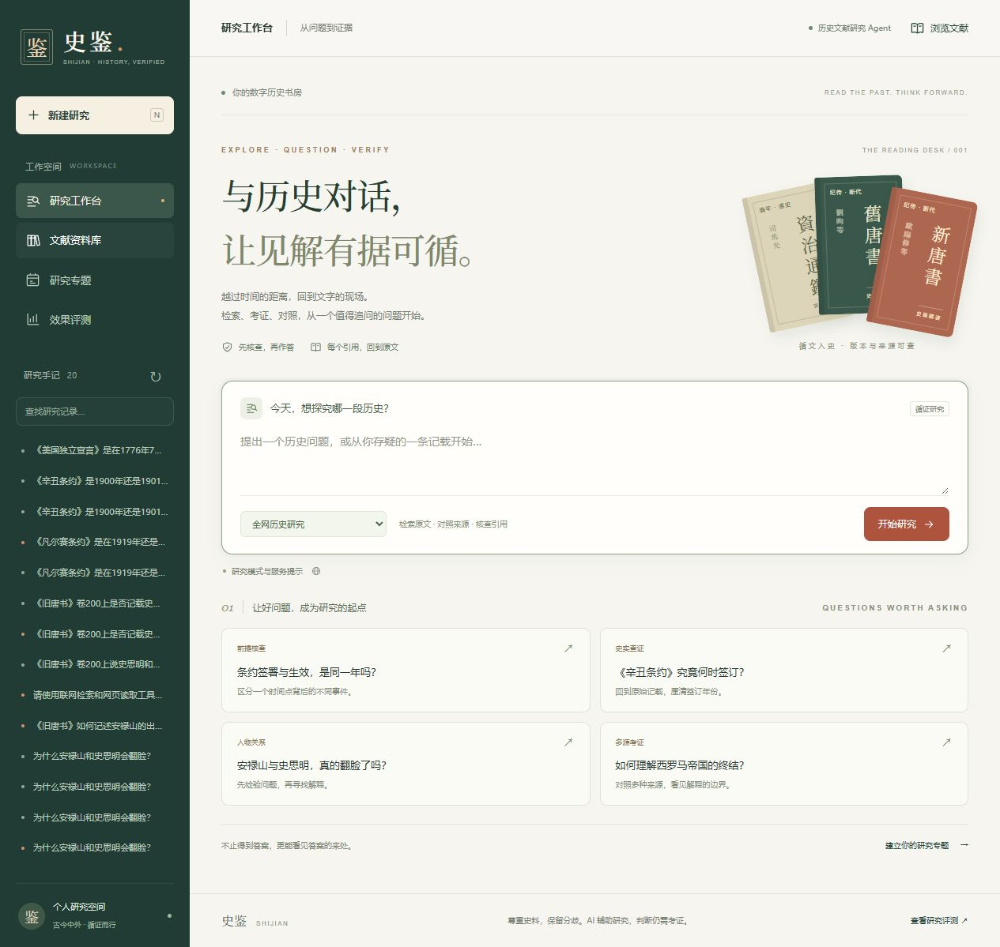
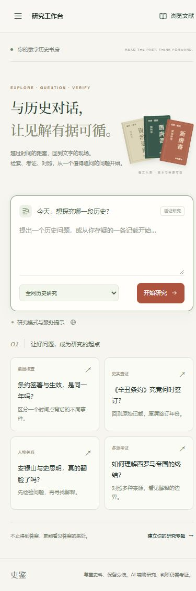
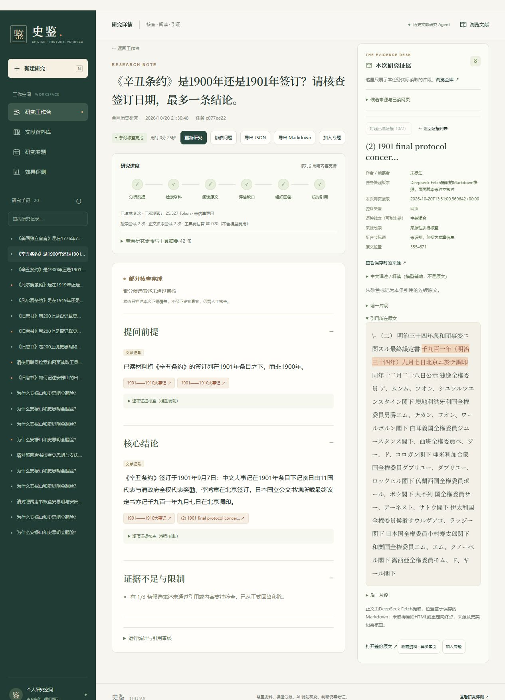
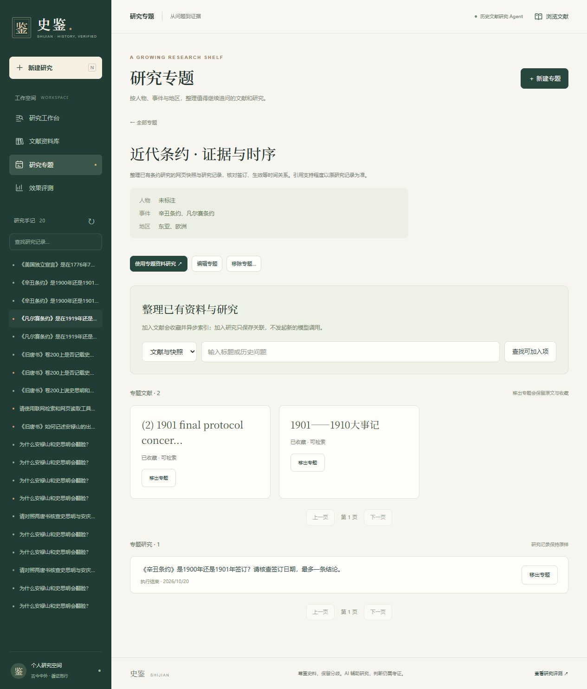

# 史鉴界面重做

2026-10-21。原生 HTML/CSS/JavaScript 重做，前端资源版本 `v=16`，本机入口 `http://127.0.0.1:8000/?ui=16`。

## 视觉与页面

深墨绿工作区导航、暖白阅读区、朱砂操作按钮、宋体标题与原文，统一线性 SVG 图标。首页以问题输入为中心，三册古籍封面由 HTML/CSS 绘制，可进入对应书名的真实资料筛选；封面为导航设计，不冒充原始版本封面或影印件。没有外部字体、图像请求或新增前端框架。

欢迎页、研究进度及结果、证据阅读、资料库筛选、专题、原文详情、评测和弹窗采用同一套样式。研究正文和本次证据分区，引用高亮保留；文献列表、编辑、异步索引状态与专题功能保留。手机端导航使用抽屉，关闭时设置 inert，支持 Escape 关闭和焦点返回。装饰图标对屏幕阅读器隐藏；遵循 reduced-motion。

原样式整体替换，未继续追加覆盖补丁。以本轮开始时的三个前端文件为基线：CSS 增561/删1764行、HTML增59/删41行、JavaScript增36/删4行；共新增656行、移除1809行，净减1153行。其中新增 JavaScript 主要为书名筛选、导航焦点与快捷键，没有增加后端校验或持久化抽象。

## 实际检查

- JavaScript `node --check`、项目 Ruff、三个前端文件 `git diff --check` 通过。
- HTML解析、标签闭合、全部134个既有交互ID保留、146个ID无重复、13处 SVG 引用完整、JS固定ID目标均存在。
- `tests/test_online_p2.py tests/test_api_worker.py`：15 passed，7.19秒。测试使用明确标注的模型替身，不等于真实历史回答测试；本次没有重复完整基础设施回归。
- 浏览器实际检查1280px桌面和390px手机：首页无横向溢出，手机抽屉展开、关闭、Escape及焦点返回可用；桌面菜单按钮隐藏。
- 古籍封面「旧唐书」进入书名筛选，显示实际导入的资料；手机文献筛选与导入弹窗能够打开和关闭，未上传新文件。
- 已有完成任务 `c077ee22-aec5-45f4-af12-de8bf37f582a` 能显示结果、阶段及证据；点击日本档案引用，原文高亮仍精确为「千九百一年（明治三十四年）九月七日北京ニ於テ調印」。不修改该历史记录的来源与审核局限。
- 已有失败任务 `663494c9-107f-44cd-94b3-86ec729a7ffe` 显示失败原因、已读证据、修改问题和重新研究入口；未点击重新研究。
- 已有专题详情、其2份资料和1条研究记录正常展示；「使用专题资料研究」能选择该专题与限定资料模式，未提交付费研究。
- 评测页面显示既有真实记录及空白人工评分，未补写分数。浏览器未观察到 error/warn。
- 采用现有锁定依赖离线增量构建，仅更新 API 容器。未迁移或清空数据库，未修改 worker、Agent、引用检查等后端逻辑。

本轮新增 DeepSeek / Search / Fetch 请求均为 **0**，模型 Token **0**。未创建生产研究任务、未进行新的回答质量评测；运行中外部模型任务未专门新建验证。截图来自真实本机页面，显示的是旧研究结果。

